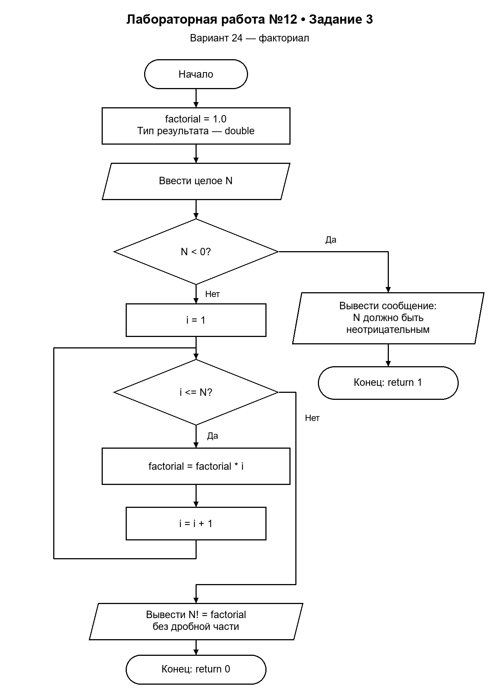

# Лабораторная работа №12

## Задание 3. Вариант 24 — факториал

Вычислить произведение **N! = 1 · 2 · … · N** для заданного пользователем целого неотрицательного числа `N` с использованием цикла `for`. Чтобы избежать целочисленного переполнения, результат вычисляется как вещественное число.

## Переменные

| Переменная | Тип | Назначение |
| --- | --- | --- |
| `N` | `int` | Число, факториал которого вычисляется |
| `i` | `int` | Счётчик цикла |
| `factorial` | `double` | Накопленное произведение, начальное значение — `1.0` |

## Алгоритм

1. Ввести `N` с клавиатуры.
2. Если `N` отрицательное, вывести сообщение и завершить программу.
3. В цикле `for` от `1` до `N` включительно умножать `factorial` на `i`.
4. Вывести результат без дробной части.

При `N = 0` цикл не выполняется, результат остаётся равным `1`: **0! = 1**.

## Пример

```text
Введите N: 5
5! = 120
```

Тип `double` имеет ограниченную точность и диапазон: для больших `N` результат может быть приближённым или переполниться.

## Блок-схема задания 3


